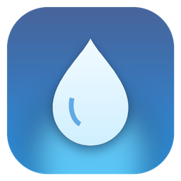
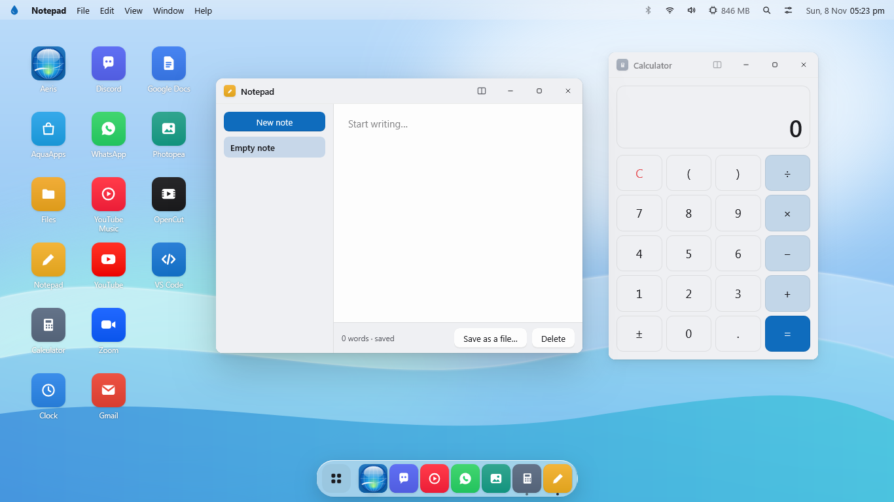
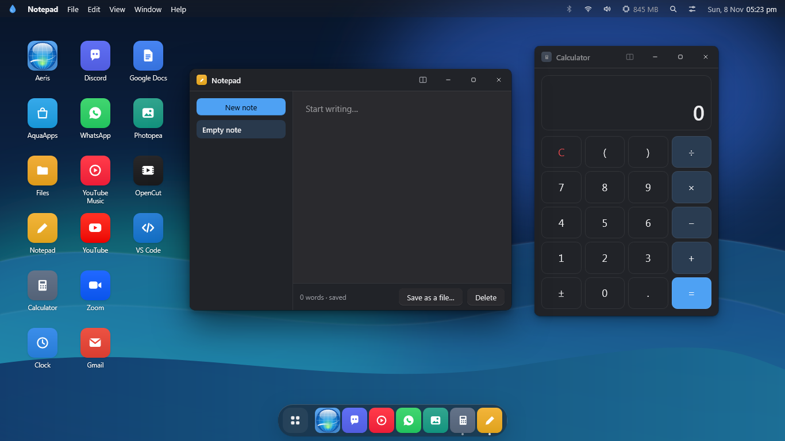
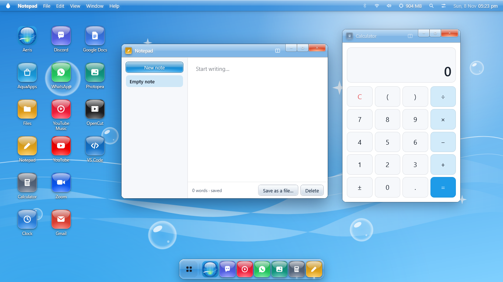
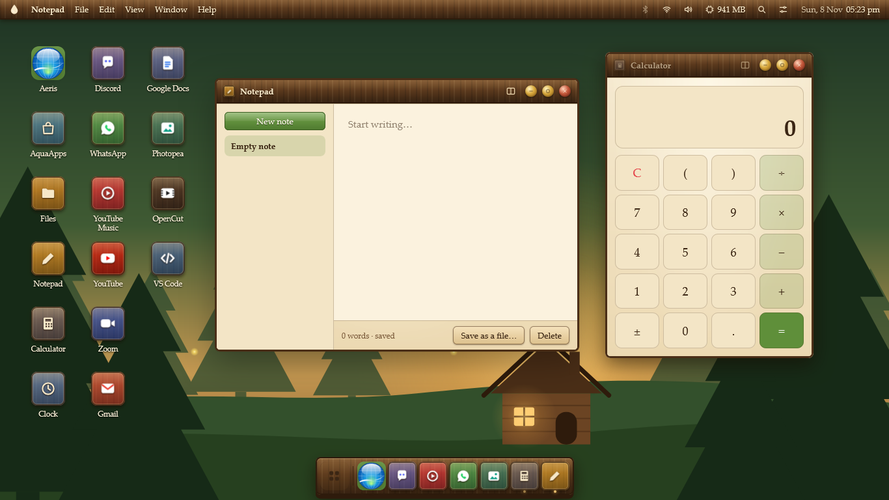
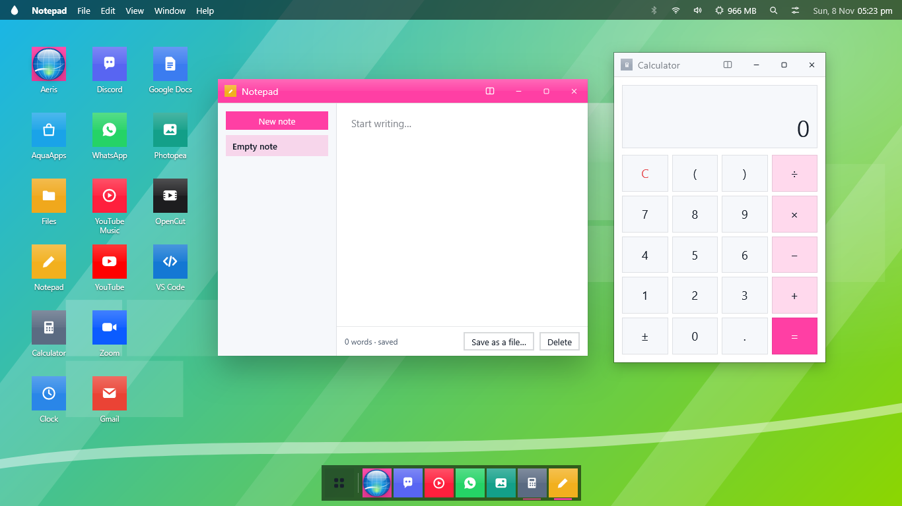
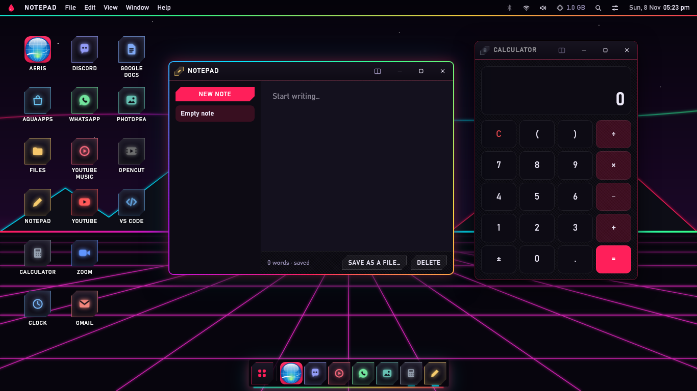
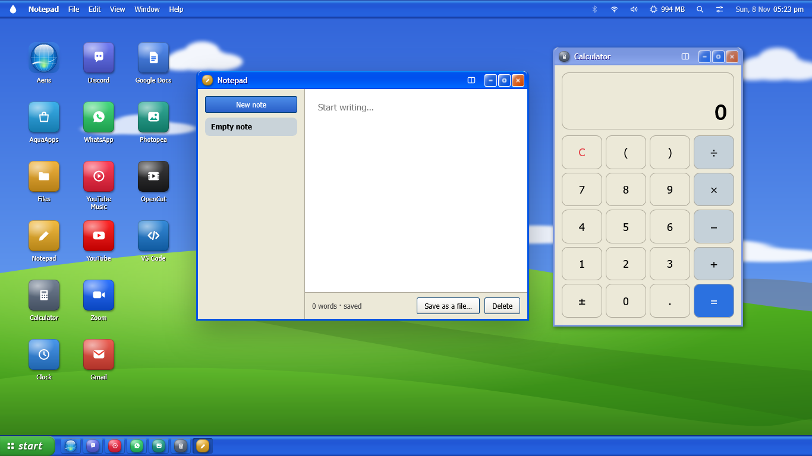
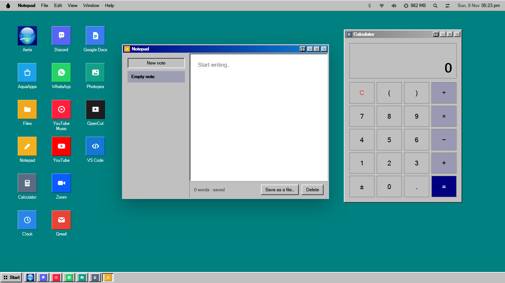
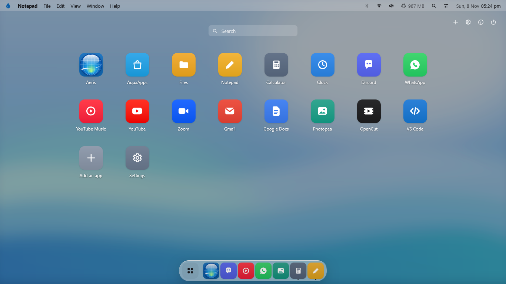

<p align="center"></p>

<h1 align="center">Aquaris</h1>

<p align="center"><b>A whole desktop made of web apps, running on one browser engine.</b><br>
Windows · macOS · Linux · iPad</p>

<p align="center"></p>

---

## What is Aquaris?

Apps like Discord, WhatsApp, Zoom and VS Code on your computer are really **websites**, each packed
with its own copy of a whole browser. Five of them means five browsers running at once, eating
memory.

Aquaris is a desktop (windows, a dock, a menu bar, a start menu, settings) where those apps run
as their **website versions, all sharing one engine**. It looks and works like an operating system,
so you open it and live in it, but it uses far less memory than the usual desktop apps.

Aquaris is built into **[Aeris](https://github.com/aarshabhpeeyush/aero-browser)**, a browser
based on Firefox. On a computer, Aeris *is* the engine underneath Aquaris, and the real Aeris
browser opens inside it as one of its apps.

## Download

Get the files from the **[latest release](../../releases/latest)**.

| Your device | Download | How to install |
|---|---|---|
| **Windows** 10/11 (64-bit) | `Aeris-Setup-1.3.0.exe` | Run it. It installs Aeris and puts **Aquaris** in the Start menu. Aquaris can start itself when your PC starts (you can turn that off in Settings). |
| **Mac** with an Apple chip (M1 or newer) | `Aeris-1.3.0-mac-arm64.dmg` | Open it and drag **Aeris** and **Aquaris** into Applications. The apps aren't signed by Apple, so the first time, **right-click → Open** on each one. |
| **Linux** (64-bit) | `Aeris-1.3.0-x86_64.AppImage` | Make it runnable (`chmod +x`), then right-click → **Aquaris**, or run it with `--aquaris`. There's also a `.tar.xz` if you prefer to unpack it. |
| **iPad** (and iPhone) | `Aquaris-iPad-1.3.0.ipa` | Install it with **[AltStore Classic](https://altstore.io)** or SideStore and your free Apple ID (steps below). |

### Installing on an iPad

Apple only lets App Store apps in normally, so the iPad version is installed the way developers test
their own apps:

1. On a Windows PC or Mac, install **AltServer** from [altstore.io](https://altstore.io). It needs
   **iTunes and iCloud from Apple's website** (not the Microsoft Store versions).
2. Plug the iPad in with a cable (one that carries data), unlock it and tap **Trust**.
3. AltServer → **Install AltStore** → pick the iPad → sign in with an Apple ID.
4. On the iPad: **Settings → General → VPN & Device Management** → trust your Apple ID, and turn on
   **Settings → Privacy & Security → Developer Mode**.
5. Back on the computer: **Shift + click AltServer → Sideload .ipa** → choose `Aquaris-iPad-1.3.0.ipa`.

Apps installed with a free Apple ID need refreshing every 7 days. AltStore does that by itself when
the iPad and computer are on the same Wi-Fi.

## What's inside

- **Windows on a desktop**: move, resize, snap to halves and quarters, split screen, minimise into
  the dock, with smooth animations. Your windows come back where you left them.
- **A dock, a Mac-style menu bar and a start menu** (the grid button on the dock): a full-screen
  page of every app, with search.
- **Spotlight**: <kbd>Ctrl</kbd>/<kbd>Alt</kbd> + <kbd>Space</kbd> finds apps, settings and the web,
  and does sums.
- **Window switcher**: hold <kbd>Alt</kbd>+<kbd>Shift</kbd> and press <kbd>T</kbd>. The window you
  used just before is already picked; press <kbd>T</kbd> again for the next one (or use the arrow
  keys, or click one), and let go of <kbd>Alt</kbd> to switch. <kbd>Esc</kbd> cancels.
- **Apps included**: Aeris (the browser), Discord, WhatsApp, YouTube, YouTube Music, Zoom, Gmail,
  Google Docs, Photopea, OpenCut, VS Code, and you can add any website as an app, with its own icon
  (there's an icon maker).
- **Aquaris's own apps**, made by Aquaris with nothing from the internet: Files (like Windows File
  Explorer, with Quick access), Notepad, Calculator, Clock, Paint, Weather, and **AquaApps**, the
  store to get more.
- **Control Centre**: real Wi-Fi, Bluetooth, volume, brightness and night light on Windows, Linux
  and Mac (wherever the system allows it).
- **Task manager**: memory and processor use for every app, biggest first, plus **RAM and CPU
  limiters** that put hidden apps to sleep (like Opera GX).
- **Napping**: apps you hide fall asleep after a few minutes, so they use no memory, and wake when
  you open them. Music apps keep playing.
- **Make it yours**: themes, light/dark, glass amount, corner roundness, dock size, Mac or Windows
  window buttons, your own wallpaper and pointer, desktop text, and a start-up animation and sound.

## Looks

Aquaris has its own **Minimal** style, built from what today's systems do (Windows 11's tinted
windows, macOS's glass for the floating parts, GNOME's grouped settings, Material's bold headings),
and **Frutiger Aqua**. Picking an **Aeris theme** dresses the whole desktop to match:

| | |
|---|---|
| <br>**Minimal**, dark | <br>**Frutiger Aero**: most Aeris themes, in their colours |
| <br>**Woodland Hut**: wood, parchment and a forest | <br>**Frutiger Metro**: flat tiles and a Start screen |
| <br>**Neon Gamer**: RGB edges and a neon grid | <br>**Luna XP**: an early-2000s blue-and-green desktop |
| <br>**Retro 2000**: grey bevels and a teal desktop | <br>The app page (start menu) |

## On an iPad

The iPad version is the same Aquaris, as an app. Websites like Discord refuse to be put inside
another web page, but an app can show them itself, so in the Aquaris iPad app they open **inside
Aquaris windows** with Aquaris's own title bars and dock.

- **Aeris on the iPad**: Aeris's New Tab page, toolbar, address bar and tabs, with its themes and
  Customize panel (tab layouts, tab shapes, Aeris Mods). It runs on Apple's engine, since Apple
  doesn't allow Firefox's on iPads.
- **Touch**: tap to open, hold for the menu, **two-finger tap** for the right-click menu,
  **three-finger tap** for Spotlight, and **swipe sideways with two fingers** for the window
  switcher (right for the next window, left to go back; lift your fingers to switch). With a
  keyboard, <kbd>Option</kbd>+<kbd>Shift</kbd>+<kbd>T</kbd> works too.
- **Game controllers** (PlayStation or Xbox): the controller becomes a mouse.

| Button | Does |
|---|---|
| Left stick / D-pad | Move the cursor |
| **R1** | Click (hold to drag) |
| **L1** | Right-click |
| **X** (Cross on PlayStation) | Spotlight |
| Triangle / Y | App page |
| Circle / B | Back |
| Square (PS) / A (Xbox) | Control Centre |
| R2 / L2 | Next / previous window |
| Right stick | Scroll |
| Options / Menu | Aquaris menu |
| Share / View | Show the desktop |
| Left stick click | Slow, precise cursor |
| Right stick click (R3) | Window switcher: press again to move along; it switches after a moment (or click a tile with R1) |

## Good to know

- **Spotify doesn't play** in Aquaris: it only works in browsers with Google's paid copy-protection
  licence. Aquaris uses **YouTube Music** instead.
- The downloads **aren't signed** by Microsoft or Apple (that costs money every year), so Windows
  SmartScreen and macOS may warn you the first time. They're built in the open by GitHub Actions in
  the [aero-browser](https://github.com/aarshabhpeeyush/aero-browser) repo.
- **Typing with a controller** on the iPad still needs a finger tap on the text box: iPadOS only
  shows the keyboard for a real touch.
- Aquaris keeps its own sign-ins, separate from your normal Aeris.

## How it's put together

```
aquaris/          the desktop itself: one HTML page, its styles (Minimal, Aqua and the theme
                  skins) and aquaris.js (windows, dock, apps, settings, system controls)
  system.ps1      the small Windows helper for Wi-Fi, Bluetooth, volume and brightness
                  (Linux and Mac use their own built-in tools)
aquaris-ipad/     the iPad app (Swift): shows Aquaris, and lays real web views over its windows
tools/            builds the web/iPad copy of Aquaris and turns Aeris themes into iPad styles
docs/             the screenshots above
```

On a computer, Aquaris runs as a privileged page inside Aeris (its own window, taskbar entry and
profile), so it can open real browser views in its windows and reach the system. On the iPad it's
the same page inside a small app.

**Building it**: Aquaris is built as part of Aeris. The build scripts and GitHub Actions workflows
for every platform live in **[aero-browser](https://github.com/aarshabhpeeyush/aero-browser)**
(`.github/workflows`: Windows, Linux, Mac and iPad).

## Thanks

Built on **[Firefox](https://www.mozilla.org/firefox/)** by Mozilla and its contributors.
Aeris comes with **[uBlock Origin](https://github.com/gorhill/uBlock)**.
The look of the retro themes is a fond nod to early-2000s desktops. Aquaris isn't made by or connected to Microsoft or Apple.
